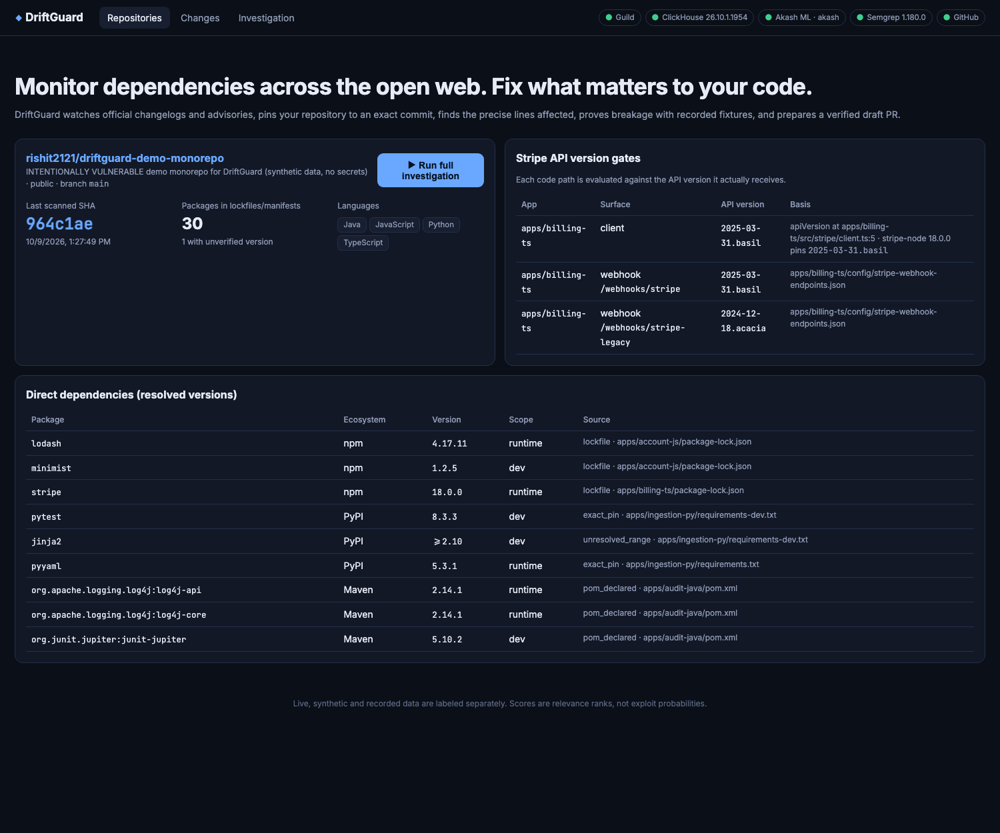
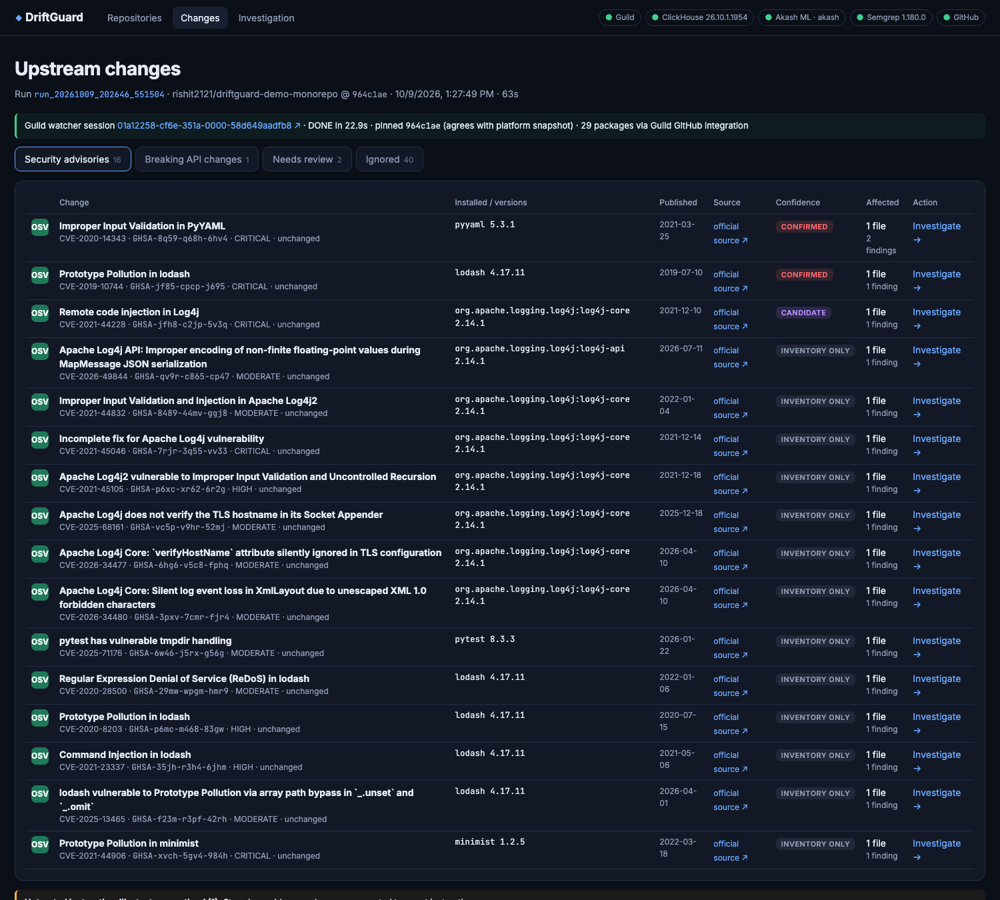
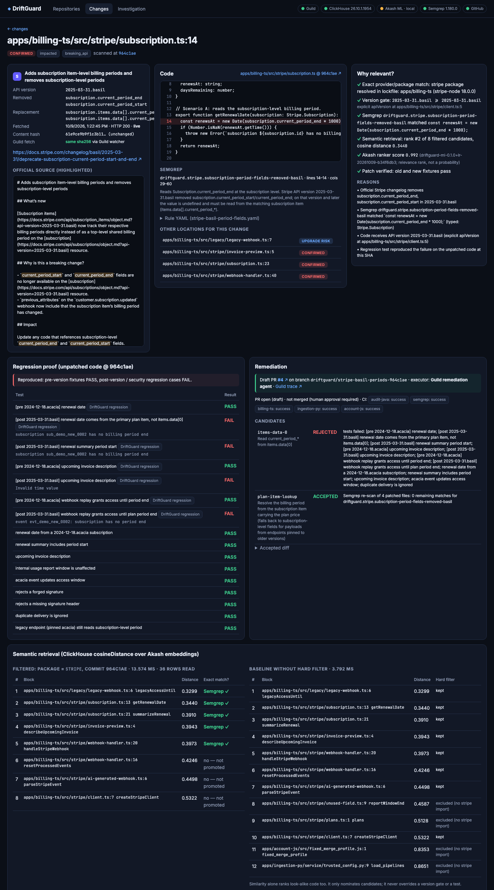
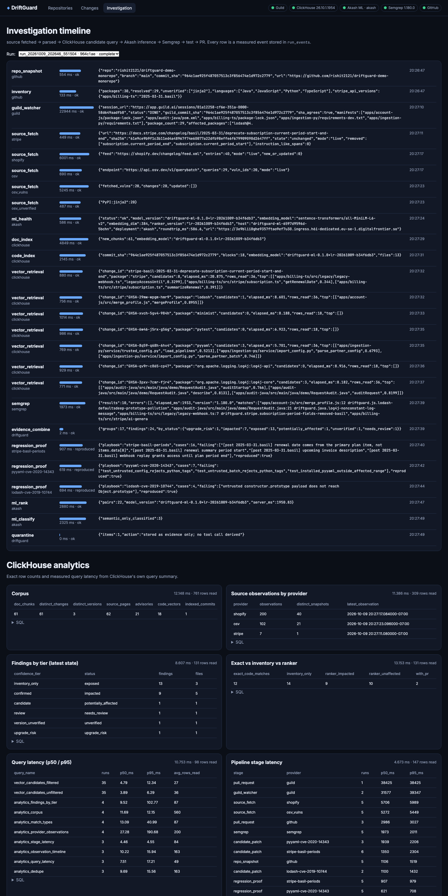

# DriftGuard

**When the outside world changes, DriftGuard tells you exactly what breaks in your code and prepares a verified fix.**

DriftGuard watches official API changelogs (Stripe, Shopify) and vulnerability advisories (OSV). It pins your
repository to an exact commit and finds the precise file, line and symbol affected. It then proves the breakage with
recorded pre- and post-change fixtures and opens an evidence-backed **draft** pull request. A human approves every
merge.

It keeps two kinds of problem apart, because each has its own source of truth and its own validation:

| | (A) Vulnerable dependency versions | (B) API contract drift |
|---|---|---|
| Authority | OSV advisory + deterministic version-range evaluation of the *resolved* version | Official changelog (parsed "Removed/Added" table) + the API version each code path *actually receives* |
| Code evidence | Semgrep rule for the affected API (e.g. `yaml.full_load`, `_.defaultsDeep`) | Type-aware Semgrep rule (`Stripe.Subscription.current_period_end`, incl. destructuring aliases) |
| Proof | Inert security regression test (e.g. a benign prototype-pollution marker, a `!!python/tuple` tag) | Replay of recorded pre-version (`acacia`) and post-version (`basil`) fixtures through production code |
| Fix gate | Tests pass **and** OSV no longer lists the installed version for the advisory; remaining advisories are disclosed | Tests pass **and** a Semgrep re-scan of the patched files finds 0 matches |

**Launch principle.** Semantic search finds candidates. Official advisories and version comparisons are the
authority. Semgrep provides the code-level evidence. Regression tests are the deciding proof.

---

## Live demo artifacts

- Demo repository (intentionally vulnerable, synthetic, no secrets): https://github.com/rishit2121/driftguard-demo-monorepo
- Draft PRs opened by DriftGuard, each with citations, before/after test tables, rejected candidates and green CI:
  - [#4 Stripe 2025-03-31.basil, opened by the **Guild remediator agent**](https://github.com/rishit2121/driftguard-demo-monorepo/pull/4) (scanned at `964c1ae`)
  - [#1 Stripe 2025-03-31.basil billing periods, earlier scan `cead8a9`, direct-GitHub fallback](https://github.com/rishit2121/driftguard-demo-monorepo/pull/1). `items.data[0]` was rejected; the plan-item lookup was accepted.
  - [#2 PyYAML CVE-2020-14343](https://github.com/rishit2121/driftguard-demo-monorepo/pull/2). 5.4 and 5.4.1 failed to build and were rejected; 6.0.3 with `safe_load` was accepted.
  - [#3 lodash CVE-2019-10744](https://github.com/rishit2121/driftguard-demo-monorepo/pull/3). A shallow `Object.assign` broke nested defaults and was rejected; 4.18.1 was accepted.
- Benchmark: `benchmark/run_benchmark.py` in the demo repo. The latest report is in `benchmark/benchmark_report.json`.

## Screenshots

| | |
|---|---|
|  Connected repository, resolved versions, Stripe API version gates |  Security advisories, sorted by confidence tier |
|  Finding: official source, pinned code, Semgrep, why-relevant, regression proof, PR + CI |  Investigation timeline and ClickHouse analytics |

## Architecture

```
[Guild: driftguard-watcher (schedule/manual)]      [DriftGuard UI / CLI: "Run full investigation"]
        |  GitHub integration: branch -> SHA, lockfiles        |
        |  experimental-fetch: Stripe changelog .md, OSV       v
        +-----------------------------> driftguard.pipeline -------------------------------+
                                         |                                                  |
   sources.py  (allowlist + SSRF guard, sha256 per fetch, disclosed snapshot fallback)      |
   inventory.py (package-lock / exact pins / pom properties; Stripe SDK default API version |
                 read live from the published stripe-node package; per-webhook versions)   |
                                         v                                                  |
   ClickHouse: source_observations, doc_chunks, code_symbols, findings, run_events, ...     |
     hard filter (repo, SHA, package) -> cosineDistance(embedding, change_vector)           |
                                         ^                                                  |
   Akash ML service: /embed (MiniLM-L6-v2, 384d)  /rank (LR ranker)  /classify               |
   Semgrep: 5 narrow, tested rules -> path/line/col/offset of the matched expression         |
                                         v                                                  |
   analysis.py: evidence combiner -> confidence tier (confirmed / likely / candidate /       |
                upgrade_risk / inventory_only / version_unverified / review)                |
   remediation.py: regression proof in isolated worktrees -> candidate patches ->           |
                   reject any candidate that fails ANY test -> Semgrep/OSV re-check          |
                                         v                                                  |
   pr.py -> [Guild: driftguard-remediator] blob/tree/commit/ref -> draft PR (never merges) <-+
            (fallback: direct GitHub API with the operator token, disclosed in the PR body)
   GitHub Actions on the PR: billing-ts, account-js, ingestion-py, audit-java, semgrep
```

### Sponsor integrations: what is real today

| Sponsor | Role | Status in this build | Evidence |
|---|---|---|---|
| **Guild.ai** | Watcher agent (source discovery) and remediator agent (opens the draft PR via Guild's GitHub integration) | **Live.** `rishit.agrawal121~driftguard-watcher` and `~driftguard-remediator` are published in the `driftguard` workspace. Each investigation starts a Guild watcher session that pins the SHA, reads the lockfiles through Guild's GitHub integration, and fetches Stripe/OSV through Guild's fetch tool. Its commit SHA and SHA-256 hashes are cross-checked against the platform's own fetch. [PR #4](https://github.com/rishit2121/driftguard-demo-monorepo/pull/4) was opened by the Guild remediator (`app/guild-ai-platform`). PRs #1–#3 were opened earlier, before Guild was authorized, by the disclosed direct-GitHub fallback. | Guild session links in the timeline, the finding page and the PR body |
| **ClickHouse** | Source snapshot history, code/doc vectors, cosine retrieval, findings, run timeline, query latency | **Live** (ClickHouse 26.10 server; set `CLICKHOUSE_HOST/…` for ClickHouse Cloud) | UI → Investigation: every query shows ClickHouse-reported `elapsed_ms` and `rows_read` |
| **Akash** | Embedding + ranking inference service | **Live on Akash.** Deployment dseq `1791577117700` on an audited provider (Sweden), 2 CPU / 3Gi, about $0.14/day, bearer-token auth. `/health` reports `deployment: akash`. Akash vectors match the local build (cosine 1.000 on probe texts), so stored embeddings are never mixed across model versions. Typical `/embed` is about 40 ms on the server and about 450 ms round trip from the US. The deployment has a 48-hour spend cap (`runtimeLimitHours`). Extend it or redeploy with `ml_service/deploy.yaml` (the image is built by the `ml-image` workflow). | `/health`, UI header pill, `ml_health`/`ml_rank` timeline stages with model version and latency |
| **Semgrep** | Code-level localization and security patterns | **Live**: 5 rules, each with `ruleid:`/`ok:` tests (`semgrep --test semgrep-rules`). Scans run on the read-only checkout at the pinned SHA. | Rule YAML + matched expression on every finding |
| GitHub (action target) | Snapshot by SHA, fix branches, draft PRs, CI | **Live** | PR links + check runs |

## Results on the demo repository (measured)

Benchmark (`benchmark/run_benchmark.py`, 7 impacted scenarios, 8 negative/edge checks):

| Metric | Value |
|---|---|
| Case recall | 7 / 7 |
| False positives on known-safe cases | 0 / 8 |
| Exact line localization | 7 / 7 (TS, JS, Python, Java) |
| Confidence tier agreement | 7 / 7 |
| Version correctness (pinned/dev/unverified not called broken) | 3 / 3 |

This is a small, purpose-built corpus. The same team wrote the rules and the cases, so these are exact counts on
this repository, not a general accuracy claim.

Ranker (`ml_service/models/metrics.json`): 104 hand-annotated synthetic pairs, with shopify, log4j and jinja2 held out
as the test set (train N=68, test N=22).

| Variant | Test F1 | Test ROC-AUC | Leave-one-provider-out F1 |
|---|---|---|---|
| Full | 0.842 | 0.975 | 0.884 |
| Without cosine (semantic) feature | 0.842 | 0.988 | 0.871 |
| Without `semgrep_match` | 0.700 | 0.835 | 0.739 |

Semgrep evidence carries most of the signal, while embedding similarity adds little beyond the exact features. That
is why DriftGuard uses similarity only to find candidates. The scores are ranks, not calibrated probabilities.

## Edge cases covered (all exercised on the demo repo)

1. **Pinned old API version.** `legacy-webhook.ts` receives `2024-12-18.acacia` payloads, so it is reported as `upgrade_risk`, not broken.
2. **Look-alike field.** `UsageReport.current_period_end` is not matched (typed Semgrep rule). Pure similarity still ranks it high (shown as a baseline in the UI).
3. **Safe loader.** `yaml.safe_load` in `trusted_config.py` is listed under "uses that correctly did not match".
4. **Dev-only dependency.** `minimist` is reported as an inventory exposure, not runtime reachability.
5. **Aliased destructuring.** `const { current_period_end: periodEnd } = subscription` in another module is found and patched.
6. **A fix that breaks valid behavior is rejected.** Examples are `items.data[0]` and a shallow `Object.assign`.
7. **Re-fetches are hash-deduplicated.** Every fetch is kept in `source_observations`, alerts are keyed deterministically, and the dedupe table is in the UI.
8. **Instruction-like text** in untrusted docs (`fixtures/docs/mirror-with-injected-instructions.md`) is quarantined and never acted on.
9. **Webhook endpoints pinned to different API versions** are each evaluated separately.
10. **No lockfile** (`Jinja2>=2.10`) gives `version_unverified`; the version is never guessed.
11. **Upgrade targets are chosen with OSV.** lodash 4.17.12 fixes CVE-2019-10744 but still carries 6 advisories, so 4.18.1 is chosen. For log4j, 2.15.0 still carries 6 advisories, so 2.25.4 is recommended.
12. **Branch moved since the scan.** DriftGuard re-scans before the PR (e.g. `subscription.ts: line 13 -> 14`) and rebuilds on the new head.

## Quickstart

Prerequisites: Node ≥ 23.6, Python 3.12 + [uv](https://github.com/astral-sh/uv), git, `gh auth login` (or `GITHUB_TOKEN`), and `uv tool install semgrep`.

```bash
git clone https://github.com/rishit2121/driftguard && cd driftguard
uv venv -p 3.12 .venv && uv pip install -p .venv/bin/python -r requirements.txt
(cd ml_service && ../.venv/bin/python train_ranker.py)   # reproduces models/ranker.joblib + metrics.json
./scripts/start.sh                                        # ClickHouse + ML service + API/UI on http://127.0.0.1:8080
```

Then open http://127.0.0.1:8080 and click **Run full investigation**. On a finding with a reproduced failure, click
**Prepare verified fix & open draft PR**.

CLI:

```bash
.venv/bin/python -m driftguard investigate                       # full run, prints findings
.venv/bin/python -m driftguard remediate <run_id> <group_key> --dry-run
python ../driftguard-demo-monorepo/benchmark/run_benchmark.py   # scores the latest run
```

Configuration (environment variables):

| Variable | Default | Purpose |
|---|---|---|
| `DRIFTGUARD_REPO` / `DRIFTGUARD_BRANCH` | `rishit2121/driftguard-demo-monorepo` / `main` | The only repository the platform will scan or write to |
| `CLICKHOUSE_HOST/PORT/USER/PASSWORD/SECURE` | `localhost:8123` | Use ClickHouse Cloud by setting `CLICKHOUSE_SECURE=1` |
| `ML_SERVICE_URL`, `ML_SERVICE_TOKEN` | `http://localhost:8100` | Point at the Akash deployment (settings may also be placed in a gitignored `.env`) |
| `DRIFTGUARD_PR_EXECUTOR` | `github` | `guild` routes PR creation through the Guild remediator agent |
| `GUILD_REMEDIATOR_AGENT`, `GUILD_WATCHER_AGENT` | – | `owner~agent` names after `guild agent save --publish` |

## Trust model

- Fetched pages, advisories, READMEs and code comments are **evidence, not instructions**. Instruction-like spans are detected, quarantined and displayed. No tool call is ever derived from them. Both Guild agents are deterministic coded agents.
- Only allowlisted HTTPS hosts can be fetched. Every redirect hop is re-validated, and hosts resolving to private, loopback or link-local addresses are rejected (`security.py`, unit-tested).
- Scans run on a read-only checkout at an immutable SHA. Remediation runs in a separate isolated worktree per candidate.
- PRs are drafts on `driftguard/*` branches. There is no merge or deploy capability, and the remediator agent is given no merge tool.
- Tests use inert probes only: no RCE payloads, no JNDI lookups, and no real Stripe secrets (a throwaway `whsec_` test secret signs replayed fixtures).
- Live, recorded and synthetic data are labeled. Stripe/OSV snapshots are used only as a **disclosed** fallback (`source_mode: cached_snapshot`).

## Repository layout

```
driftguard/        pipeline, sources, inventory, versions, upgrades, codeindex, semgrep_runner, analysis, remediation, pr, api
driftguard/templates/   regression tests + helper inserted by playbooks
semgrep-rules/     5 rules + annotated rule tests
clickhouse/schema.sql
ml_service/        FastAPI /embed /rank /classify, ranker training, Dockerfile, Akash SDL
guild/             driftguard-watcher + driftguard-remediator Guild agents
web/               UI (Repositories, Changes, Finding detail, Investigation/analytics)
tests/             unit tests (version gates, SSRF guard, codemod parsers)
```

## Sources

Guild GitHub integration https://docs.guild.ai/integrations/github · Guild triggers https://docs.guild.ai/platform/triggers ·
ClickHouse vector search https://clickhouse.com/docs/reference/engines/table-engines/mergetree-family/annindexes ·
Akash https://akash.network/docs/ · Semgrep rule syntax https://docs.semgrep.dev/writing-rules/rule-syntax ·
OSV API https://google.github.io/osv.dev/api/ ·
Stripe change https://docs.stripe.com/changelog/basil/2025-03-31/deprecate-subscription-current-period-start-and-end ·
CVE-2020-14343 https://nvd.nist.gov/vuln/detail/CVE-2020-14343 · CVE-2019-10744 https://osv.dev/vulnerability/CVE-2019-10744 ·
CVE-2021-44228 https://osv.dev/vulnerability/CVE-2021-44228
